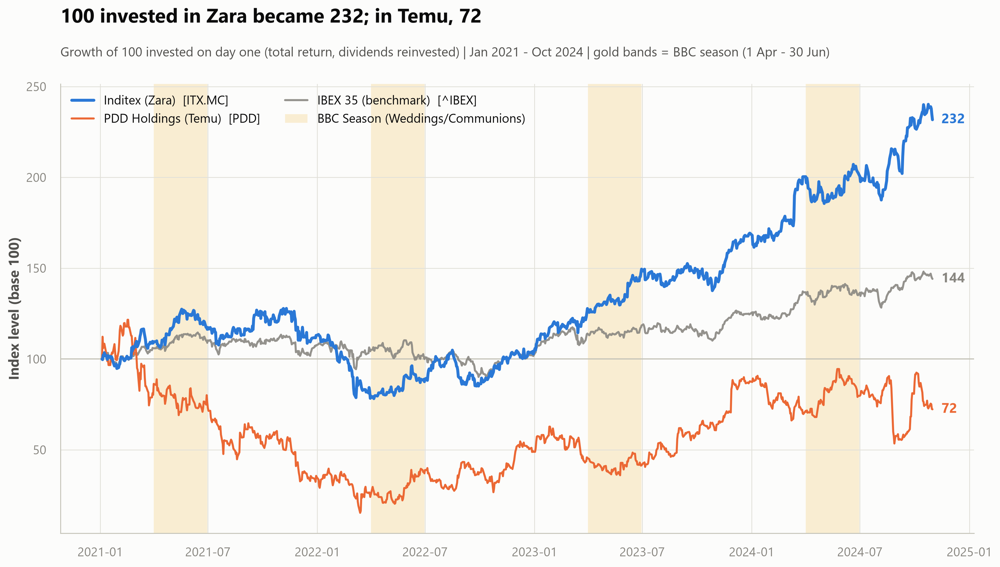

# Zara vs Temu: ¿puede un avión chino llegar a tiempo a una boda española?

> 🌍 **Español** · [English](README.md)

## ▶ Resumen rápido

[](presentation/Zara_s_Event_Armor.mp4)

*Un recorrido visual de 7 minutos por todo el estudio — la pregunta, la prueba y
lo que dicen los datos. Haz clic en la imagen para reproducirlo en GitHub.*

**Exploratory Data Analysis — Módulo Data Analysis | Bootcamp Data Science, The Bridge**

Análisis exploratorio del *near-shoring* ágil occidental (Inditex / Zara) frente
al *ultra-fast fashion* chino transfronterizo (PDD Holdings / Temu), usando como
banco de pruebas una ventana cultural que no se puede enviar por avión: **la
Temporada de BBC** — Bodas, Bautizos y Comuniones, de abril a junio en España.

<p align="center">
  
</p>

---

## El caso de negocio

De abril a junio, España celebra su temporada de bodas, bautizos y comuniones.
No es una campaña comercial más: es un acontecimiento social con código de
vestimenta, fotografías que duran décadas y tolerancia **cero** a tres cosas
que un envío transfronterizo no puede garantizar — que el paquete llegue antes
del día de la ceremonia, que la talla sea la correcta, y que el tejido no
transparente en las fotos.

Resultado: la clienta acude a la tienda física a por la *colección de invitada*,
se prueba la prenda y la recoge en 24 h, **a precio completo**. Esa es la
ventaja que el near-shoring monetiza. Este proyecto la busca en los datos de
mercado.

| | Ticker | Papel |
|---|---|---|
| **Target** | `ITX.MC` | Inditex — fabricación ágil en España, Portugal, Marruecos y Turquía (~15 días de diseño a percha) |
| **Competidor** | `PDD` | PDD Holdings (Temu) — proxy cotizado del modelo Shein: carga aérea directa de fábrica china |
| **Benchmark** | `^IBEX` | IBEX 35 — referencia del mercado español |

**Datos:** Yahoo Finance vía `yfinance` · 2021-01-01 → 2024-11-01 · 991 sesiones

---

## Hipótesis y resultados

Las tres hipótesis se formularon **antes** de mirar los datos, y las tres son
falsables. Una de ellas no se cumple — y es la más interesante.

| # | Hipótesis | Veredicto | Evidencia |
|---|---|---|---|
| **H1** | Zara genera alpha en temporada BBC frente al IBEX **y** frente a Temu | ❌ **No se cumple** | Bate al IBEX (+13,5 pb/día, p=0,026) pero **no** a PDD (−10,7 pb/día, n.s.) |
| **H2** | Zara tiene menor volatilidad y menos días de desplome que Temu | ✅ **Se cumple** | 24,9% vs 75,6% anualizada (3,0×) · Levene p<0,001 · 5 vs 87 días por debajo de −5% |
| **H3** | El volumen de Zara repunta de forma consistente en Q2 | ✅ **Se cumple, con matiz** | +38,3% vs resto del año · 4/4 años · p<0,001 — pero concentrado en **abril** |

### La conclusión

**El near-shoring no se cobra en rentabilidad, se cobra en ausencia de sustos.**
Zara no batió a Temu durante la temporada de bodas (H1 rechazada), pero entregó
un **+131,8%** de rentabilidad total con un **24,9%** de volatilidad, frente al
**−27,7%** de PDD con un **75,6%**. Y durante la temporada BBC, Inditex no tuvo
**ni una sola** sesión por debajo del −5%; el peor día de PDD en todo el periodo
fue **−28,5%**.

---

## Estructura del proyecto

```
my-eda-project/
├── README.md                    # inglés (principal)
├── README.es.md                 # este documento (español)
├── SETUP.md / SETUP.en.md       # guía de instalación paso a paso (ES / EN)
├── requirements.txt
├── tests/
│   └── test_project.py          # 85 tests de verificación
├── presentation/                # el entregable de presentación
└── src/
    ├── main.py                  # pipeline end-to-end (CLI)
    ├── app.py                   # demo interactivo (Streamlit)
    ├── memoria.ipynb            # MEMORIA: el desarrollo completo, ejecutado
    ├── data/
    │   ├── raw/                 # payload sin tocar de yfinance (caché)
    │   └── processed/           # tablas listas para análisis
    ├── notebooks/
    │   └── 01_sandbox.ipynb     # pruebas y exploración previa
    └── utils/
        ├── config.py            # parámetros, rutas, paleta
        ├── audit.py             # ledger de formas y guardas de NaN
        ├── ingestion.py         # descarga, caché, alineación de calendarios
        ├── features.py          # retornos, base 100, máscara de evento
        ├── analysis.py          # tablas y tests de H1 / H2 / H3
        └── viz.py               # los 4 gráficos a 300 DPI
└── reports/
    ├── figures/                 # 4 PNG a 300 DPI para la presentación
    └── tables/                  # 16 tablas en markdown + ledger de auditoría
```

---

## Cómo ejecutarlo

> 📖 **¿Primera vez?** [**SETUP.md**](SETUP.md) lo explica todo paso a paso,
> desde instalar Python hasta lanzar la app — sin dar por supuesto nada.

```bash
# 1. Entorno virtual
python -m venv .venv
.\.venv\Scripts\Activate.ps1      # Windows PowerShell
source .venv/Scripts/activate     # Windows Git Bash
source .venv/bin/activate         # macOS / Linux
python -m pip install -r requirements.txt

# 2. Análisis completo
python src/main.py                # descarga datos frescos de Yahoo Finance
python src/main.py --offline      # reejecuta desde la caché en src/data/raw/
python src/main.py --no-charts    # solo tablas (iteración rápida)

# 3. Demo interactivo
streamlit run src/app.py

# 4. Memoria
jupyter lab src/memoria.ipynb

# 5. Verificar que todo funciona (85 tests, ~50 s)
python -m pytest tests/ -v
```

La memoria **ya viene ejecutada** (se lee en GitHub sin instalar nada) y se
reejecuta entera sin conexión, porque reutiliza la caché.

---

## Demo interactivo

`streamlit run src/app.py` levanta un dashboard de 6 pestañas pensado como
apoyo a la presentación: cada hipótesis combina su gráfico definitivo a 300 DPI
con controles que recalculan los números **en directo** delante del público.

Dos momentos preparados para la defensa:

* **«¿Y si tu limpieza de datos está creando el resultado?»** → marca *«Solo
  sesiones reales»*: excluye todos los días imputados por forward-fill y la
  conclusión de H2 no se mueve.
* **El umbral de desplome** → llévalo a −10%: Zara se queda en **0 sesiones**,
  Temu en **12**.

---

## Tests

```bash
python -m pytest tests/ -v
```

**85 tests** en [`tests/test_project.py`](tests/test_project.py), sin necesidad
de conexión. Cubren diez bloques: estructura del repositorio, ingesta,
**higiene de datos**, feature engineering, análisis estadístico, **los
veredictos de las tres hipótesis**, gráficos, dashboard, notebooks y enlaces de
la documentación.

Los más valiosos son los que blindan las conclusiones: si algún día los datos
dejaran de respaldar lo que dicen la memoria y la presentación, los tests
avisan **antes** de la defensa, no durante.

---

## Higiene de datos: las decisiones que sostienen el análisis

Lo que más puede tumbar un proyecto de datos es perder filas sin darse cuenta.
Aquí cada transformación se audita:

**1. `Adj Close`, no `Close`.** Inditex reparte cada año dividendo ordinario más
extraordinario. Sobre el cierre bruto, cada fecha *ex-dividendo* aparece como un
desplome del ~3% que nunca existió — e inflaría artificialmente el riesgo de
Inditex, que es justo lo que mide H2. Se descarga con `auto_adjust=False` y hay
*fallback* explícito con aviso si una versión futura de `yfinance` retira la
columna.

**2. Forward-fill, nunca `.dropna()`.** Madrid y Nueva York no comparten
festivos. Un `.dropna()` general habría destruido **35 filas (3,5% de la
muestra)**: todos los días en los que *alguno* de los dos mercados cerraba. Y el
sesgo no sería aleatorio — la Semana Santa cae siempre en marzo/abril, justo en
el borde de la ventana estudiada. Se aplica `.ffill()` (un mercado cerrado no
ha publicado información nueva) y solo se eliminan los `NaN` de frontera.

**3. El volumen NO se rellena.** Un mercado cerrado negoció cero acciones.
Arrastrar la sesión anterior a un festivo inventaría liquidez — precisamente la
magnitud que mide H3. Los festivos se dejan como `NaN` y las medias mensuales se
calculan solo sobre sesiones reales.

**4. Control de robustez del forward-fill.** Cada día rellenado produce un
retorno de 0,00%, y los ceros reducen la desviación típica. Como H2 afirma que
Zara es *menos* volátil, H2 se calcula **dos veces**: sobre el panel completo y
solo sobre sesiones reales. La conclusión no cambia — el resultado es una
propiedad de las empresas, no de la limpieza.

**5. Ledger de auditoría.** `reports/tables/audit_ledger.md` registra filas y
columnas en cada paso. Las dos únicas variaciones de tamaño están justificadas:
−1 fila en los retornos (el primer día no tiene `t−1`) y +1 en el acumulado (el
ancla base 100).

---

## Stack técnico

`Python` · `pandas` · `numpy` · `scipy` (Welch, Mann-Whitney, Wilcoxon, Levene /
Brown-Forsythe, test F) · `matplotlib` · `seaborn` · `yfinance` · `Streamlit` ·
`Jupyter`

---

## Limitaciones declaradas

Correlación no es causalidad: medimos que el patrón existe, no que las bodas lo
causen. PDD es un proxy imperfecto de Shein (incluye Pinduoduo, que no compite
con Zara). Las series están en divisa local — convertir a una única divisa
habría mezclado la volatilidad del EUR/USD en el perfil de riesgo de PDD. Solo
hay 4 temporadas BBC en la ventana, y el periodo incluye la reapertura
post-COVID y el shock inflacionista de 2022. La sección 8.3 de la memoria lo
desarrolla.
