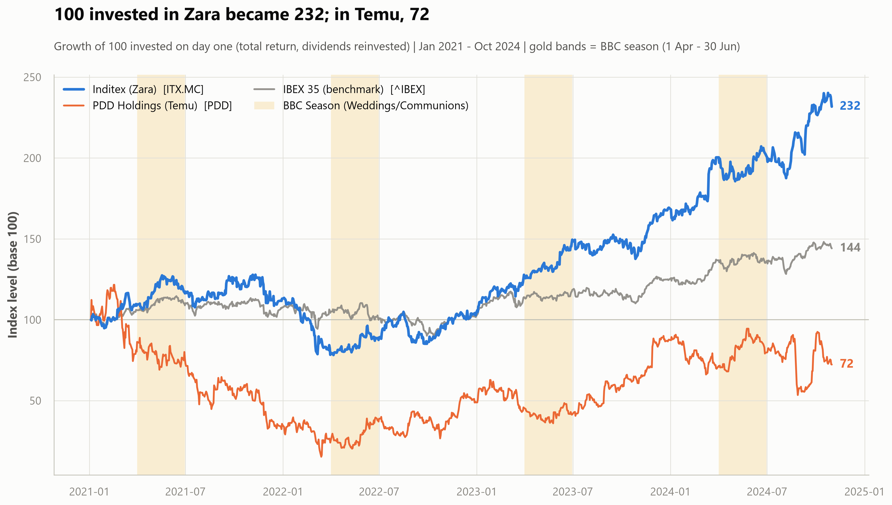

# Zara vs Temu: can a Chinese plane make it to a Spanish wedding on time?

> 🌍 **English** · [Español](README.es.md)

## ▶ Quick overview

[](presentation/Zara_s_Event_Armor.mp4)

*A 7-minute visual walkthrough of the whole study — the question, the test, and
what the data says. Click the image to play it on GitHub.*

**Exploratory Data Analysis — Data Analysis module | Data Science Bootcamp, The Bridge**

An exploratory analysis of Western agile *near-shoring* (Inditex / Zara) against
Chinese cross-border *ultra-fast fashion* (PDD Holdings / Temu), tested against
a cultural window that cannot be air-freighted: **the BBC Season** — *Bodas,
Bautizos y Comuniones* (weddings, christenings and first communions), April to
June in Spain.

<p align="center">
  
</p>

---

## The business case

From April to June, Spain runs its season of weddings, christenings and first
communions. This is not just another retail campaign: it is a social event with
a dress code, photographs that last decades, and **zero** tolerance for three
things a cross-border shipment cannot guarantee — that the parcel arrives
before the ceremony, that the size is right, and that the fabric isn't
see-through in the photos.

The result: the shopper walks into a physical store for the *colección de
invitada* (guest collection), tries the outfit on, and collects it within 24
hours — **at full price**. That is the advantage near-shoring monetises. This
project goes looking for it in market data.

| | Ticker | Role |
|---|---|---|
| **Target** | `ITX.MC` | Inditex — agile manufacturing in Spain, Portugal, Morocco and Turkey (~15 days from design to rack) |
| **Competitor** | `PDD` | PDD Holdings (Temu) — the listed proxy for the Shein model: air freight direct from Chinese factories |
| **Benchmark** | `^IBEX` | IBEX 35 — Spanish market baseline |

**Data:** Yahoo Finance via `yfinance` · 2021-01-01 → 2024-11-01 · 991 sessions

---

## Hypotheses and results

All three hypotheses were stated **before** looking at the data, and all three
are falsifiable. One of them fails — and it is the most interesting one.

| # | Hypothesis | Verdict | Evidence |
|---|---|---|---|
| **H1** | Zara generates alpha in BBC season over the IBEX **and** over Temu | ❌ **Not supported** | Beats the IBEX (+13.5 bps/day, p=0.026) but **not** PDD (−10.7 bps/day, n.s.) |
| **H2** | Zara shows lower volatility and fewer crash days than Temu | ✅ **Supported** | 24.9% vs 75.6% annualised (3.0×) · Levene p<0.001 · 5 vs 87 days below −5% |
| **H3** | Zara's trading volume builds up consistently in Q2 | ✅ **Supported, with a caveat** | +38.3% vs the rest of the year · 4/4 years · p<0.001 — but concentrated in **April** |

### The conclusion

**Near-shoring isn't paid for in returns, it's paid for in the absence of
shocks.** Zara did not beat Temu during the wedding season (H1 rejected), but
it delivered **+131.8%** total return at **24.9%** volatility, against PDD's
**−27.7%** at **75.6%**. And during the BBC season, Inditex had **not a single**
session below −5%; PDD's worst day over the whole period was **−28.5%**.

---

## Project structure

```
my-eda-project/
├── README.md                    # English (primary) — this file
├── README.es.md                 # Spanish mirror
├── SETUP.md / SETUP.en.md       # step-by-step install guide (ES / EN)
├── requirements.txt
├── tests/
│   └── test_project.py          # 85 verification tests
├── presentation/                # the presentation deliverable
└── src/
    ├── main.py                  # end-to-end pipeline (CLI)
    ├── app.py                   # interactive demo (Streamlit)
    ├── memoria.ipynb            # THE REPORT: full write-up, already executed
    ├── data/
    │   ├── raw/                 # untouched yfinance payload (cache)
    │   └── processed/           # analysis-ready tables
    ├── notebooks/
    │   └── 01_sandbox.ipynb     # scratch work and prior exploration
    └── utils/
        ├── config.py            # parameters, paths, palette
        ├── audit.py             # shape ledger and NaN guards
        ├── ingestion.py         # download, cache, calendar alignment
        ├── features.py          # returns, base 100, event mask
        ├── analysis.py          # H1 / H2 / H3 tables and tests
        └── viz.py               # the four 300-DPI charts
└── reports/
    ├── figures/                 # 4 PNGs at 300 DPI for the presentation
    └── tables/                  # 16 markdown tables + the audit ledger
```

> **Note on language:** the report (`memoria.ipynb`) and the app UI are in Spanish,
> because the evaluation panel is Spanish-speaking, and all **code, comments and
> docstrings are in English**. This README is the English version;
> [`README.es.md`](README.es.md) is the Spanish mirror.

---

## How to run it

> 📖 **First time?** [**SETUP.en.md**](SETUP.en.md) walks through everything
> step by step, from installing Python to launching the app — assuming nothing.

```bash
# 1. Virtual environment
python -m venv .venv
.\.venv\Scripts\Activate.ps1      # Windows PowerShell
source .venv/Scripts/activate     # Windows Git Bash
source .venv/bin/activate         # macOS / Linux
python -m pip install -r requirements.txt

# 2. Full analysis
python src/main.py                # downloads fresh data from Yahoo Finance
python src/main.py --offline      # re-runs from the cache in src/data/raw/
python src/main.py --no-charts    # tables only (fast iteration)

# 3. Interactive demo
streamlit run src/app.py

# 4. The report
jupyter lab src/memoria.ipynb

# 5. Verify everything works (85 tests, ~50 s)
python -m pytest tests/ -v
```

The report **ships already executed** (readable on GitHub with nothing
installed) and re-runs end to end offline, because it reuses the cache.

---

## Interactive demo

`streamlit run src/app.py` launches a six-tab dashboard built as presentation
support: each hypothesis pairs its final 300-DPI chart with controls that
recompute the numbers **live** in front of the audience.

Two moments prepared for the defence:

* **"What if your data cleaning is creating the result?"** → tick *"Solo
  sesiones reales"* (real sessions only): it drops every forward-filled day and
  H2's conclusion doesn't move.
* **The crash threshold** → drag it to −10%: Zara stays at **0 sessions**,
  Temu at **12**.

---

## Tests

```bash
python -m pytest tests/ -v
```

**85 tests** in [`tests/test_project.py`](tests/test_project.py), no network
required. Ten blocks: repo structure, ingestion, **data hygiene**, feature
engineering, statistics, **the three hypothesis verdicts**, charts, dashboard,
notebooks and documentation links.

The most valuable ones pin the conclusions down: if the data ever stopped
supporting what the report and the slides claim, the tests say so **before**
the defence rather than during it.

---

## Data hygiene: the decisions holding the analysis up

The fastest way to kill a data project is to lose rows without noticing. Every
transformation here is audited:

**1. `Adj Close`, not `Close`.** Inditex pays a large ordinary plus
extraordinary dividend every year. On the raw close, each *ex-dividend* date
shows up as a ~3% crash that never happened — artificially inflating Inditex's
measured risk, which is exactly what H2 measures. Downloaded with
`auto_adjust=False`, with an explicit, loudly announced fallback in case a
future `yfinance` version removes the column.

**2. Forward-fill, never `.dropna()`.** Madrid and New York don't share
holidays. A blanket `.dropna()` would have destroyed **35 rows (3.5% of the
sample)**: every day on which *either* market was closed. And the bias wouldn't
be random — Semana Santa always falls in March/April, right on the edge of the
window being studied. We apply `.ffill()` (a closed market has published no new
information) and remove only the boundary `NaN`s.

**3. Volume is NOT filled.** A closed market traded zero shares. Carrying the
previous session into a bank holiday would invent liquidity — precisely the
quantity H3 measures. Holidays stay `NaN` and monthly averages use real
sessions only.

**4. Forward-fill robustness check.** Every filled day produces a 0.00% return,
and zeros pull a standard deviation down. Since H2 claims Zara is *less*
volatile, H2 is computed **twice**: on the full panel and on genuine sessions
only. The conclusion is unchanged — the result is a property of the companies,
not of the cleaning.

**5. Audit ledger.** `reports/tables/audit_ledger.md` records rows and columns
at every step. The only two size changes are justified: −1 row in the returns
(the first day has no `t−1`) and +1 in the cumulative series (the base-100
anchor).

---

## Tech stack

`Python` · `pandas` · `numpy` · `scipy` (Welch, Mann-Whitney, Wilcoxon, Levene /
Brown-Forsythe, F-test) · `matplotlib` · `seaborn` · `yfinance` · `Streamlit` ·
`Jupyter`

---

## Stated limitations

Correlation is not causation: we measured that the pattern exists, not that
weddings cause it. PDD is an imperfect proxy for Shein (it includes Pinduoduo,
which does not compete with Zara). Series are in local currency — converting to
a single currency would have blended EUR/USD volatility into PDD's risk
profile. There are only 4 BBC seasons in the window, and the period covers both
the post-COVID reopening and the 2022 inflation shock. Section 8.3 of the
report develops this.
